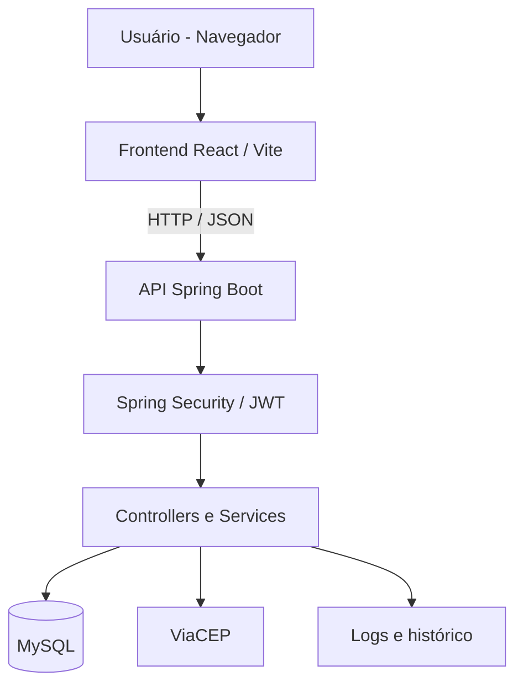
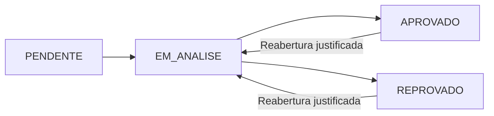

<div align="center">

# GAEA
### Gestão e Acompanhamento de Estágios Acadêmicos

**Uma plataforma web para organizar, acompanhar e dar transparência aos processos de estágio.**

    

[Sobre](#sobre-o-projeto) · [Funcionalidades](#funcionalidades) · [Tecnologias](#tecnologias) · [Execução](#como-executar) · [Documentação](#documentação)

</div>

---

## Sobre o projeto

O **GAEA** é um Projeto de Finalização de Curso (PFC) de Sistemas de Informação. Seu objetivo é centralizar o cadastro e o acompanhamento de estágios acadêmicos, facilitando a comunicação e o controle dos processos por alunos e instituições de ensino.

> **Versão de referência:** a implementação mais completa analisada está na branch `entrega0911`. A branch `main` ainda contém a versão inicial; sua atualização deve ocorrer após revisão e validação. Algumas funcionalidades existem na API, mas ainda precisam ser verificadas ponta a ponta na interface.

## Funcionalidades

| Módulo | Recursos identificados no código |
| --- | --- |
| Autenticação | Cadastro, login com JWT e senhas protegidas por BCrypt |
| Perfis | Controle de acesso de aluno e instituição no backend |
| Processos | Cadastro, listagem e acompanhamento de estágios |
| Status | Pendente → Em análise → Aprovado ou Reprovado |
| Reabertura | Reabertura de processo concluído com justificativa |
| Histórico | Registro de transições e consulta de alterações |
| Auditoria | Registro e consulta de ações relevantes |
| Dashboard | Resumo de processos para instituição |
| Integração | Consulta de endereço pela API ViaCEP |
| Privacidade | Registro de aceite e documentos de privacidade |

O perfil **EMPRESA** aparece na documentação, mas ainda não possui um conjunto de permissões funcionais identificado na configuração de segurança analisada.

## Tecnologias

| Camada | Tecnologias |
| --- | --- |
| Interface | React, JavaScript, Vite, CSS |
| API | Java 17, Spring Boot 4.1.1, Spring Web MVC |
| Segurança | Spring Security, JWT, BCrypt |
| Dados | Spring Data JPA, MySQL |
| Validação e testes | Bean Validation, JUnit, H2 (testes) |
| Serviço externo | ViaCEP |

## Arquitetura



## Fluxo do processo de estágio



## Estrutura do repositório

```text
GAEA-PFC/
├── docs/                       # Documentação do projeto
├── frontend/                   # Interface React
│   └── src/
├── src/
│   ├── main/java/Gaea/Api/     # Controllers, DTOs, modelos e serviços
│   ├── main/resources/         # Configurações
│   └── test/                   # Testes automatizados
├── pom.xml
└── README.md
```

## Como executar

**Pré-requisitos:** Java 17, Node.js com npm e MySQL.

1. Crie um banco local `gaea` no MySQL.
2. Configure `DB_PASSWORD` e `JWT_SECRET` como variáveis de ambiente. Use um segredo JWT imprevisível com pelo menos 32 bytes. Confira as configurações de banco em `src/main/resources/application.properties`.
3. Inicie o backend na raiz do projeto (Windows):

   ```powershell
   .\mvnw.cmd spring-boot:run
   ```

4. Em outro terminal, inicie o frontend:

   ```powershell
   cd frontend
   npm ci
   npm run dev
   ```

5. Abra o endereço informado pelo Vite. Verifique se o frontend está configurado para consumir a API local.

### Testes e verificações

Na raiz do projeto:

```powershell
.\mvnw.cmd test
```

Na pasta `frontend`:

```powershell
npm run lint
npm run build
```

**Observação:** estes são comandos disponíveis para validação, não resultados de testes executados nesta atualização de documentação.

## Segurança e LGPD

O GAEA possui mecanismos de autenticação, autorização, proteção de senhas, auditoria e documentos de privacidade. **Esses mecanismos não representam, isoladamente, conformidade integral com a LGPD.** Antes de utilizar dados reais, ainda é necessário avaliar bases legais, retenção, direitos dos titulares, segregação de dados, gestão de credenciais e tratamento de incidentes.

Consulte os documentos em [docs/lgpd](docs/lgpd) e o [plano de melhorias](docs/qualidade/PLANO_DE_MELHORIAS.md).

## Documentação

- [Política de Privacidade](docs/lgpd/PoliticaPrivacidade.md)
- [Termos de Uso](docs/lgpd/termos_de_uso.md)
- [Integração ViaCEP](docs/integrações/viacep.md)
- [Plano de melhorias técnicas](docs/qualidade/PLANO_DE_MELHORIAS.md)

## Entregas acadêmicas

| Branch | Marco |
| --- | --- |
| `entrega1409` | Cadastro e acompanhamento inicial |
| `entrega2809` | Autenticação, auditoria, ViaCEP e LGPD |
| `entrega0911` | Histórico, dashboard, validações e testes |

## Situação atual

**Em desenvolvimento acadêmico.** A documentação descreve funcionalidades identificadas na branch `entrega0911`, sem afirmar que a aplicação foi homologada para produção.

---

<div align="center">
